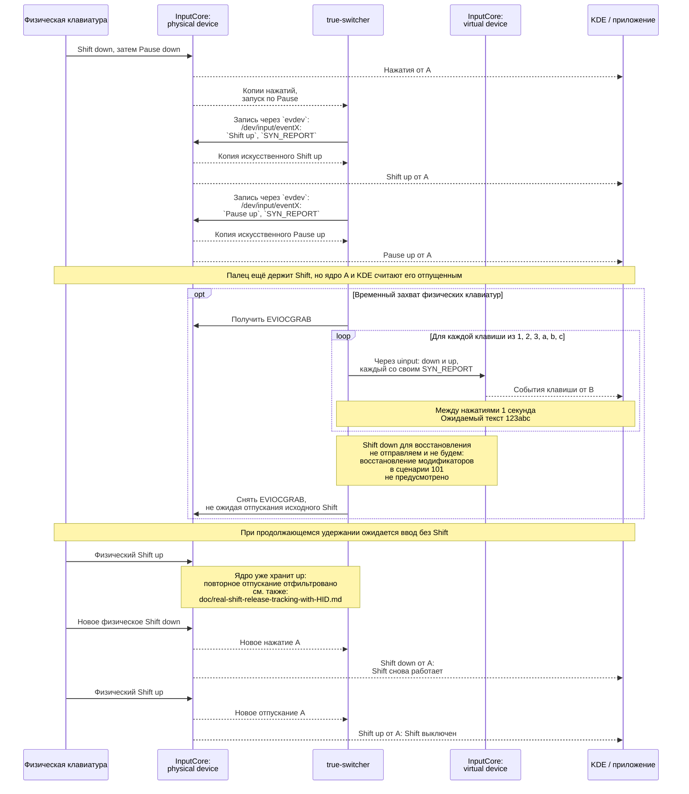

# Задача 101. Эксперимент со сбросом Shift через исходное физическое устройство

- [x] Написана отдельная программа `src/bin/experiment-101.rs`, запуск `make run-modifier-experiment-101`, режим `EXPERIMENT_ARGS=--shifted`.
- [x] Подготовлена [инструкция запуска и ручных тестов](../experiment-101.md).
- [ ] Провести ручные тесты в KDE Plasma на Wayland и записать результаты. В среде реализации нет `/dev/input` и `/dev/uinput`; поведение KDE не подтверждено.
- Основа — сценарий [задачи 100](100.md), программа `src/bin/experiment-100.rs` и её [описание](../modifier-experiment.md).
- Новое решение основано на [идее искусственного отпускания Pause](../pause-sticking-solution.md).
- Эксперимент проверяет возможный подход для [задачи 5.3](5.3.md), но не меняет основной свитчер и согласованный план его работы.
- Номер 101 относится к отдельной нумерации побочных задач.
- запуск сделать через мейкфайл как для задачи 100

## Цель и ожидаемое поведение

Проверить, можно ли снять влияние физически удерживаемого левого Shift, отправив искусственное отпускание через исходное физическое устройство, и выполнить синтетический ввод без ожидания физического отпускания Shift и Pause.

После исправления удержание Shift **не восстанавливается**. Допустимо, что пользователь продолжает держать кнопку, а окружение считает её отпущенной. Для повторного включения Shift пользователь должен физически отпустить и заново нажать его. Это согласованное поведение эксперимента.

## Решения из обсуждения

- Потеря эффекта физически удерживаемого Shift после исправления приемлема для пользователя. Это не дефект эксперимента и не причина добавлять восстановление модификатора.
- Не требуется сохранять прежнее поведение «продолжил держать Shift — продолжил печатать заглавными». Новое ожидаемое поведение — сброс до отпускания и повторного нажатия.
- Проблема неизвестного физического состояния мешает безопасному восстановлению Shift. Если восстановление не требуется, сама по себе эта проблема не опровергает новый подход.
- Провал задачи 100 относится к проверенному способу с отдельным устройством `uinput`. Он не доказывает невозможность нейтрализации через исходное физическое устройство.
- Искусственное отпускание потенциально применимо и к Pause, и к Shift. Прежняя формулировка «на модификаторы этот вывод не распространяется» была неточной: различие определяется требованиями к восстановлению, а не запретом на отпускание модификаторов.
- Пока согласован новый эксперимент, а не внедрение решения в основной свитчер. Его результаты должны показать, можно ли пересмотреть ожидание отпускания исходного Shift в плане 5.3.

## Суть нового решения

В эксперименте 100 `Shift up` отправлялся через отдельную виртуальную клавиатуру `uinput`. При ручном тесте он не снял влияние физического Shift. Восстановленный через `uinput` Shift затем оставался активным после физического отпускания. Результат описан в задаче 5.3; журнал — `modifier-experiment-2026-11-01_23-00-51.023377201Z-0.log`.

В новом эксперименте порядок другой:

1. Получить физический `Shift down` и запомнить исходное устройство.
2. При физическом `Pause down`, **до захвата**, записать `EV_KEY / KEY_LEFTSHIFT / value=0` и завершающий `SYN_REPORT` в тот же `/dev/input/eventX`, откуда пришёл `Shift down`.
3. Аналогично отправить `Pause up` с `SYN_REPORT` через устройство, откуда пришёл `Pause down`. Это может быть другая клавиатура.
4. Захватить физические клавиатуры и выполнить тестовый ввод через `uinput`.
5. Завершить синтетический ввод и вернуть прямую доставку физических событий, не восстанавливая Shift и Pause.

Linux позволяет внедрять события записью через `evdev`: запись в `/dev/input/eventX` меняет состояние исходного устройства в input core. Отпускание должно прийти окружению от того же устройства, что и исходное нажатие. Именно это отличает новый подход от задачи 100. После `EVIOCGRAB` новые события этого устройства получает только владелец захвата, поэтому отпускания для KDE отправляются до захвата.

Искусственное отпускание меняет состояние клавиши в ядре. Последующее физическое отпускание может быть отброшено как повторное; состояние evdev после внедрения нельзя считать независимым показателем физического удержания. Поэтому не пытаться восстанавливать Shift по этому состоянию и не ждать обязательного физического `up` для уже искусственно отпущенных Shift и Pause.

Работоспособность подхода в KDE пока не подтверждена. Очередь KDE и программа работают независимо: завершение записи и `SYN_REPORT` не подтверждают, что KDE уже применил отпускание. Захват не отменяет события, ранее попавшие в очередь KWin. Подробнее об уровнях состояния и доставке — в [карте системы ввода](../input-system-map.md).

## Диаграмма сценария

Ниже **ожидаемый успешный сценарий**, который эксперимент должен подтвердить, в обычном режиме без синтетического Shift. A и B — два разных устройства в ядре; стрелки к KDE включают доставку через `evdev` и `libinput`. Для компактности Shift и Pause показаны на одном устройстве A. Если это разные устройства, каждое отпускание записывается в своё исходное устройство.

Блок `loop` показывает последовательные нажатия. Блок `opt` обозначает время захвата, а не необязательность этого шага; виртуальное устройство B продолжает доставлять события в KDE.

Диаграмма опускает посторонний ввод во время захвата. Он отбрасывается; обычные клавиши и новые нажатия должны быть отпущены перед снятием захвата. Возврат влияния исходного удерживаемого Shift, например из-за повторных событий устройства, означал бы, что показанный ожидаемый сценарий не подтвердился.

Идея независимого наблюдения физического отпускания описана отдельно в [документе о HID](../real-shift-release-tracking-with-HID.md). Восстановление исходных модификаторов в сценарий 101 не входит.

## Требования к программе

- Отдельная программа и отдельная команда запуска. Эксперимент 100 и его журнал сохранить для сравнения; можно использовать его код как основу.
- Использовать существующую зависимость `evdev`; настройки системы не менять. Для записи отпусканий нужен доступ к физическим устройствам на запись, для тестового ввода — к `/dev/uinput`.
- Открыть физические клавиатуры, исключив свою виртуальную. Вне захвата ввод поступает в окружение напрямую; проксирование не используется.
- До запуска сценария отслеживать нажатия с привязкой к устройству. Если левый Shift нажат на нескольких открытых клавиатурах, отпускание требуется на каждой из них.
- Начальный сценарий рассчитан на удержание только левого Shift и Pause. Остальные клавиши перед запуском отпущены.
- Один запуск программы выполняет одну последовательность по `Shift+Pause`, затем только наблюдает ввод до завершения. Повторы `value=2` и собственные внедрённые события не должны запускать последовательность повторно.
- Во время захвата продолжать читать события. Физический ввод отбрасывать, не буферизовать и не воспроизводить после снятия захвата.
- Для обычных клавиш и новых нажатий во время захвата дождаться отпускания перед возвратом прямого ввода. Исходные искусственно отпущенные Shift и Pause не должны блокировать выход. Если устройство повторно сообщает их нажатие или автоповтор, записать это как результат эксперимента; не маскировать такой результат повторными искусственными отпусканиями.
- Сохранить медленную последовательность из задачи 100: отдельные нажатия и отпускания `1`, `2`, `3`, `a`, `b`, `c`, интервал между нажатиями — одна секунда. Текст вводится событиями `uinput`, а не печатается в stdout.
- Предусмотреть режим с синтетическим Shift: виртуальный `Shift down` перед последовательностью, обязательный виртуальный `Shift up` после неё и при аварийной очистке. В обычном режиме виртуальный Shift для нейтрализации физического не использовать.
- Предусмотреть Escape для завершения, снятие полученных захватов и отпускание собственных виртуальных клавиш при ошибке. Исходный физический Shift при очистке не восстанавливать.
- Создавать отдельный журнал каждого запуска без перезаписи существующих. Записывать устройства, физические события, попытки внедрения в исходные устройства и их результаты, синтетический ввод, границы захвата и очистку. Не называть все прочитанные из evdev события физическими: среди них будут собственные внедрённые отпускания.
- Подготовить инструкцию запуска и ручных тестов. Сборка и автоматические тесты не заменяют ручной результат в KDE/Wayland.

## Основной ручной тест

Условия: основной свитчер и другие эксперименты остановлены, английская US-раскладка, Caps Lock выключен. Тест выполняется в обычном терминале KDE Plasma на Wayland.

1. Запустить программу и дождаться готовности виртуальной клавиатуры. Убедиться, что обычный ввод работает напрямую.
2. Зажать левый Shift и, продолжая его удерживать, нажать Pause.
3. Программа отправляет отпускания через исходные устройства до захвата, затем захватывает клавиатуры и выполняет тестовый ввод. Ожидаемый текст — `123abc`.
4. Продолжать держать Shift до завершения последовательности и снятия захвата. Программа не должна ждать его физического отпускания и не должна восстанавливать его нажатие.
5. После снятия захвата печатать, всё ещё удерживая Shift. Ожидаются строчные буквы и цифры без Shift. Самопроизвольное возвращение влияния Shift означает, что ожидаемое поведение не подтверждено.
6. Физически отпустить Shift и продолжить печатать. Ввод остаётся без Shift, залипания нет.
7. Заново нажать Shift и проверить заглавные буквы; отпустить и проверить строчные. Новое физическое нажатие и отпускание должны работать как обычно.
8. Завершить программу через Escape.

Повторить основной тест с удержанием Pause до снятия захвата. Не должно быть ожидания её отпускания, повторного запуска последовательности или логического залипания Pause.

## Дополнительные ручные тесты

- **Синтетический Shift.** Повторить основной сценарий в соответствующем режиме. Ожидаемый текст — `!@#ABC`. После отпускания виртуального Shift и снятия захвата физически удерживаемый исходный Shift остаётся логически сброшенным.
- **Физическое отпускание во время захвата.** Отпустить исходный Shift до конца синтетического ввода. Ожидаемый текст не меняется; после снятия захвата Shift не активен. Отсутствие события физического отпускания в журнале допустимо и не является поводом восстанавливать Shift.
- **Посторонний ввод во время захвата.** Нажимать и отпускать обычные клавиши. Они не появляются ни во время последовательности, ни после снятия захвата. Если оставить обычную клавишу нажатой, возврат прямого ввода ждёт её отпускания.
- **Новое нажатие Shift во время захвата.** Отпустить исходный Shift, затем заново нажать его и удерживать до конца последовательности. Новое нажатие отбрасывается; захват сохраняется до его отпускания. После возврата прямого ввода залипания нет.
- **Разные клавиатуры.** При наличии оборудования нажать Shift на одной клавиатуре, Pause — на другой. Проверить адреса внедрения и те же ожидаемые результаты.
- **Состояние окружения.** Повторить сценарий с независимым Wayland-наблюдателем, например `wev`, в фокусе. Подтвердить получение отпусканий Shift и Pause; после смены фокуса проверить отсутствие этих клавиш в списке `wl_keyboard.enter`. Отдельно убедиться, что обычная Pause видна наблюдателю.

## Что записать в результатах

- Версию Plasma, тип сессии, раскладку, режим программы и путь к журналу.
- Фактический синтетический текст и поведение Shift после захвата, после физического отпускания и после нового нажатия.
- Получило ли окружение внедрённые отпускания; возникают ли повторные нажатия или автоповтор при продолжающемся физическом удержании.
- Появляется ли отброшенный ввод после снятия захвата, есть ли залипание Pause или Shift.
- Какие сценарии выполнены и какие остались непроверенными. Гонки на границах захвата и быстрые повторные нажатия требуют отдельных тестов; один успешный основной сценарий не подтверждает готовность решения для 5.3.
