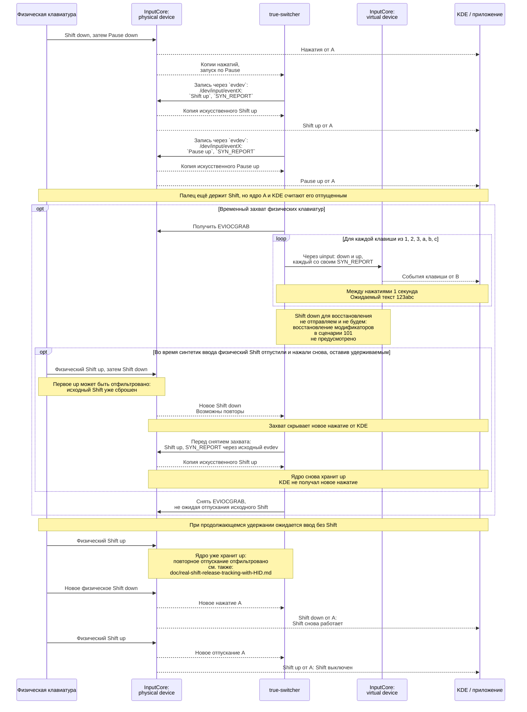

# Задача 101. Эксперимент со сбросом Shift через исходное физическое устройство

> Документ содержит актуальную схему для реализации [задачи 5.3](5.3.md). Детали эксперимента могут не покрывать всё, что принято в 5.3.

- Основа — сценарий [задачи 100](100.md), программа `src/bin/experiment-100.rs` и её [описание](../modifier-experiment.md).
- Проверенная схема эксперимента принята за основу [протокола исправления в задаче 5.3](5.3.md#протокол-исправления). Внедрение в основной свитчер остаётся отдельной работой в рамках этой задачи.
- Номер 101 относится к отдельной нумерации побочных задач.
- запуск сделать через мейкфайл как для задачи 100

## Цель и ожидаемое поведение

Проверить, можно ли снять влияние физически удерживаемого левого Shift, отправив искусственное отпускание через исходное физическое устройство, и выполнить синтетический ввод без ожидания физического отпускания Shift и Pause.

После исправления удержание Shift **не восстанавливается**. Допустимо, что пользователь продолжает держать кнопку, а окружение считает её отпущенной. Для повторного включения Shift пользователь должен физически отпустить и заново нажать его. Это согласованное поведение эксперимента.

## Результат

2026-11-02 пользователь подтвердил: эксперимент 101 успешен. Подход со сбросом Shift через исходное физическое устройство признан работоспособным в рамках эксперимента.

Для первоначального результата подробности запуска, журнал и перечень выполненных ручных сценариев не указаны. Успех эксперимента сам по себе не означает завершение задачи 5.3 или внедрение решения в основной свитчер.

2026-11-02 пользователь также подтвердил успех [второй итерации](#вторая-итерация): сценарий повторного нажатия и удержания левого Shift во время синтетического ввода прошёл в обычном режиме и с `--shifted`. Журналы и подробности приведены ниже.

## Решения из обсуждения

- Потеря эффекта физически удерживаемого Shift после исправления приемлема для пользователя. Это не дефект эксперимента и не причина добавлять восстановление модификатора.
- Не требуется сохранять прежнее поведение «продолжил держать Shift — продолжил печатать заглавными». Новое ожидаемое поведение — сброс до отпускания и повторного нажатия.
- Проблема неизвестного физического состояния мешает безопасному восстановлению Shift. Если восстановление не требуется, сама по себе эта проблема не опровергает новый подход.
- Провал задачи 100 относится к проверенному способу с отдельным устройством `uinput`. Он не доказывает невозможность нейтрализации через исходное физическое устройство.
- Искусственное отпускание потенциально применимо и к Pause, и к Shift. Прежняя формулировка «на модификаторы этот вывод не распространяется» была неточной: различие определяется требованиями к восстановлению, а не запретом на отпускание модификаторов.
- По результатам эксперимента в [актуальном плане 5.3](5.3.md#основа-подхода) ожидание отпускания исходных модификаторов и `Pause` заменено их сбросом через исходные устройства. Эксперимент сам по себе не внедряет этот протокол в основной свитчер.

## Суть нового решения

В эксперименте 100 `Shift up` отправлялся через отдельную виртуальную клавиатуру `uinput`. При ручном тесте он не снял влияние физического Shift. Восстановленный через `uinput` Shift затем оставался активным после физического отпускания. Подробности — в [результате ручного теста задачи 100](100.md#результат-ручного-теста); журнал — `modifier-experiment-2026-11-01_23-00-51.023377201Z-0.log`.

В новом эксперименте порядок другой:

1. Получить физический `Shift down` и запомнить исходное устройство.
2. При физическом `Pause down`, **до захвата**, записать `EV_KEY / KEY_LEFTSHIFT / value=0` и завершающий `SYN_REPORT` в тот же `/dev/input/eventX`, откуда пришёл `Shift down`.
3. Аналогично отправить `Pause up` с `SYN_REPORT` через устройство, откуда пришёл `Pause down`. Это может быть другая клавиатура.
4. Захватить физические клавиатуры и выполнить тестовый ввод через `uinput`.
5. Завершить синтетический ввод и вернуть прямую доставку физических событий, не восстанавливая Shift и Pause.

Linux позволяет внедрять события записью через `evdev`: запись в `/dev/input/eventX` меняет состояние исходного устройства в input core. Отпускание должно прийти окружению от того же устройства, что и исходное нажатие. Именно это отличает новый подход от задачи 100. После `EVIOCGRAB` новые события этого устройства получает только владелец захвата, поэтому отпускания для KDE отправляются до захвата.

Искусственное отпускание меняет состояние клавиши в ядре. Последующее физическое отпускание может быть отброшено как повторное; состояние evdev после внедрения нельзя считать независимым показателем физического удержания. Поэтому не пытаться восстанавливать Shift по этому состоянию и не ждать обязательного физического `up` для уже искусственно отпущенных Shift и Pause.

Пользователь подтвердил успешный результат эксперимента. При этом очередь KDE и программа работают независимо: завершение записи и `SYN_REPORT` не подтверждают, что KDE уже применил отпускание. Захват не отменяет события, ранее попавшие в очередь KWin. Подробнее об уровнях состояния и доставке — в [карте системы ввода](../input-system-map.md).

## Диаграмма сценария

Ниже **ожидаемый успешный сценарий**, который эксперимент должен подтвердить, в обычном режиме без синтетического Shift. A и B — два разных устройства в ядре; стрелки к KDE включают доставку через `evdev` и `libinput`. Для компактности Shift и Pause показаны на одном устройстве A. Если это разные устройства, каждое отпускание записывается в своё исходное устройство.



Блок `loop` показывает последовательные нажатия. Внешний блок `opt` обозначает время захвата, а не необязательность этого шага; виртуальное устройство B продолжает доставлять события в KDE. Вложенный `opt` — необязательный сценарий повторного нажатия Shift во время ввода; его сброс выполняется после синтетической последовательности под захватом. Аналогично сбрасывается правый Shift, если он был нажат во время захвата, на каждом исходном устройстве.

Диаграмма опускает прочий посторонний ввод во время захвата. Он отбрасывается; для клавиш, кроме Shift, новые нажатия должны быть отпущены перед снятием захвата. Новые нажатия и повторы Shift журналируются и сбрасываются через исходное устройство перед снятием захвата. Возвращение влияния Shift после сброса требует отдельного разбора по журналу.

Идея независимого наблюдения физического отпускания описана отдельно в [документе о HID](../real-shift-release-tracking-with-HID.md). Восстановление исходных модификаторов в сценарий 101 не входит.

## Требования к программе

- Отдельная программа и отдельная команда запуска. Эксперимент 100 и его журнал сохранить для сравнения; можно использовать его код как основу.
- Использовать существующую зависимость `evdev`; настройки системы не менять. Для записи отпусканий нужен доступ к физическим устройствам на запись, для тестового ввода — к `/dev/uinput`.
- Открыть физические клавиатуры, исключив свою виртуальную. Вне захвата ввод поступает в окружение напрямую; проксирование не используется.
- До запуска сценария отслеживать нажатия с привязкой к устройству. Если левый Shift нажат на нескольких открытых клавиатурах, отпускание требуется на каждой из них.
- Начальный сценарий рассчитан на удержание только левого Shift и Pause. Остальные клавиши перед запуском отпущены.
- Один запуск программы выполняет одну последовательность по `Shift+Pause`, затем только наблюдает ввод до завершения. Повторы `value=2` и собственные внедрённые события не должны запускать последовательность повторно.
- Во время захвата продолжать читать события. Физический ввод отбрасывать, не буферизовать и не воспроизводить после снятия захвата.
- Для новых нажатий во время захвата, кроме левого и правого Shift, дождаться отпускания перед возвратом прямого ввода. Исходные искусственно отпущенные Shift и Pause не должны блокировать выход. Новые нажатия и автоповторы журналировать. Удерживаемые левый и правый Shift сбрасывать через соответствующие исходные устройства под захватом при завершении последовательности, в том числе во время ожидания остальных клавиш. Повторно нажатую Pause не сбрасывать: для неё сохраняется ожидание отпускания.
- Сохранить медленную последовательность из задачи 100: отдельные нажатия и отпускания `1`, `2`, `3`, `a`, `b`, `c`, интервал между нажатиями — одна секунда. Текст вводится событиями `uinput`, а не печатается в stdout.
- Предусмотреть режим с синтетическим Shift: виртуальный `Shift down` перед последовательностью, обязательный виртуальный `Shift up` после неё и при аварийной очистке. В обычном режиме виртуальный Shift для нейтрализации физического не использовать.
- Предусмотреть Escape для завершения, снятие полученных захватов и отпускание собственных виртуальных клавиш при ошибке. Исходный физический Shift при очистке не восстанавливать.
- Создавать отдельный журнал каждого запуска без перезаписи существующих. Записывать устройства, физические события, попытки внедрения в исходные устройства и их результаты, синтетический ввод, границы захвата и очистку. Не называть все прочитанные из evdev события физическими: среди них будут собственные внедрённые отпускания.
- Подготовить инструкцию запуска и ручных тестов. Сборка и автоматические тесты не заменяют ручной результат в KDE/Wayland.

## Основной ручной тест

Условия: основной свитчер и другие эксперименты остановлены, английская US-раскладка, Caps Lock выключен. Тест выполняется в обычном терминале KDE Plasma на Wayland.

1. Запустить программу и дождаться готовности виртуальной клавиатуры. Убедиться, что обычный ввод работает напрямую.
2. Зажать левый Shift и, продолжая его удерживать, нажать Pause.
3. Программа отправляет отпускания через исходные устройства до захвата, затем захватывает клавиатуры и выполняет тестовый ввод. Ожидаемый текст — `123abc`.
4. Продолжать держать Shift до завершения последовательности и снятия захвата. Программа не должна ждать его физического отпускания и не должна восстанавливать его нажатие.
5. После снятия захвата печатать, всё ещё удерживая Shift. Ожидаются строчные буквы и цифры без Shift. Самопроизвольное возвращение влияния Shift означает, что ожидаемое поведение не подтверждено.
6. Физически отпустить Shift и продолжить печатать. Ввод остаётся без Shift, залипания нет.
7. Заново нажать Shift и проверить заглавные буквы; отпустить и проверить строчные. Новое физическое нажатие и отпускание должны работать как обычно.
8. Завершить программу через Escape.

Повторить основной тест с удержанием Pause до снятия захвата. Не должно быть ожидания её отпускания, повторного запуска последовательности или логического залипания Pause.

## Дополнительные ручные тесты

- **Синтетический Shift.** Повторить основной сценарий в соответствующем режиме. Ожидаемый текст — `!@#ABC`. После отпускания виртуального Shift и снятия захвата физически удерживаемый исходный Shift остаётся логически сброшенным.
- **Физическое отпускание во время захвата.** Отпустить исходный Shift до конца синтетического ввода. Ожидаемый текст не меняется; после снятия захвата Shift не активен. Отсутствие события физического отпускания в журнале допустимо и не является поводом восстанавливать Shift.
- **Посторонний ввод во время захвата.** Нажимать и отпускать обычные клавиши. Они не появляются ни во время последовательности, ни после снятия захвата. Если оставить обычную клавишу нажатой, возврат прямого ввода ждёт её отпускания.
- **Новое нажатие Shift во время захвата.** Отпустить исходный Shift, затем заново нажать его и удерживать до конца последовательности. Новое нажатие отбрасывается и сбрасывается через исходный evdev под захватом; программа снимает захват без ожидания отпускания Shift. При продолжающемся удержании ожидается ввод без Shift. После физического отпускания и нового нажатия Shift снова работает. Повторить для правого Shift, обоих Shift и обоих режимов программы, а также с обычной клавишей, задерживающей снятие захвата.
- **Разные клавиатуры.** При наличии оборудования нажать Shift на одной клавиатуре, Pause — на другой. Проверить адреса внедрения и те же ожидаемые результаты.
- **Состояние окружения.** Повторить сценарий с независимым Wayland-наблюдателем, например `wev`, в фокусе. Подтвердить получение отпусканий Shift и Pause; после смены фокуса проверить отсутствие этих клавиш в списке `wl_keyboard.enter`. Отдельно убедиться, что обычная Pause видна наблюдателю.

## Что записать в результатах

- Версию Plasma, тип сессии, раскладку, режим программы и путь к журналу.
- Фактический синтетический текст и поведение Shift после захвата, после физического отпускания и после нового нажатия.
- Получило ли окружение внедрённые отпускания; возникают ли повторные нажатия или автоповтор при продолжающемся физическом удержании.
- Появляется ли отброшенный ввод после снятия захвата, есть ли залипание Pause или Shift.
- Какие сценарии выполнены и какие остались непроверенными. Гонки на границах захвата и быстрые повторные нажатия требуют отдельных тестов; один успешный основной сценарий не подтверждает готовность решения для 5.3.

## Вторая итерация

Режим `--shifted` реализован в `src/bin/experiment-101.rs` и доступен через существующую цель Makefile. Виртуальный Shift нажимается перед последовательностью и отпускается после неё. При досрочном завершении программа пытается отпустить все свои виртуальные клавиши и снять захваты. Исходные физические Shift и Pause не восстанавливаются.

2026-11-02: сборка `cargo build --offline --bin experiment-101`, `cargo fmt --check` и `cargo clippy --offline --bin experiment-101 -- -D warnings` прошли успешно. Справка `--help` и команда Makefile с `EXPERIMENT_ARGS=--shifted` просмотрены без открытия устройств и запуска сценария. На этом этапе ручные тесты ещё не выполнялись: в среде реализации отсутствуют `/dev/input` и `/dev/uinput`.

2026-11-02: в ручных журналах обнаружено ожидание повторно нажатого Shift в обоих режимах. Например, в `experiment-101-2026-11-02_12-56-17.253885857Z-0.log` (`shifted=false`) новое нажатие пришло на 3,549 с, ожидание началось на 6,425 с и завершилось только после отпускания на 8,856 с. По согласованию ожидание для левого и правого Shift заменено сбросом через исходный evdev перед снятием захвата. Остальные новые нажатия по-прежнему требуют отпускания.

### Успешные ручные тесты второй итерации

2026-11-02 пользователь подтвердил успешный результат в обоих режимах после исправления повторного нажатия Shift:

- [Обычный режим, `shifted=false`](../../experiment-101-2026-11-02_13-09-45.488638105Z-0.log): во время захвата левый Shift неоднократно нажимался и отпускался, затем оставался удерживаемым с автоповторами. На 8,868 с выполнен успешный сброс через исходный `/dev/input/event4`, отпускание прочитано под захватом. На 8,869 с ожидание завершилось без физического отпускания Shift; к 8,906 с все захваты сняты. Последующие нажатие и отпускание Shift видны в журнале. Завершение — `FINISH Ok(())`.
- [Режим `--shifted`, `shifted=true`](../../experiment-101-2026-11-02_13-10-55.830509205Z-0.log): виртуальный Shift нажат на 6,473 с и отпущен после всей последовательности на 11,480 с. Повторно нажатый и удерживаемый физический левый Shift успешно сброшен через исходный `/dev/input/event4` под захватом. Ожидание завершилось сразу; к 11,556 с все захваты сняты. После захвата видны новые нажатия и отпускания Shift. В просмотренном журнале ошибок нет.

Эти запуски подтверждают проверенный сценарий с левым Shift в обоих режимах. Остальные дополнительные сценарии не отмечены как выполненные.

### Запуск и ограничения

Обычный сценарий:

```sh
make run-modifier-experiment-101
```

Режим `shifted`:

```sh
make run-modifier-experiment-101 EXPERIMENT_ARGS=--shifted
```

- Цель Makefile использует `systemd-run` с дополнительной группой `input`. Нужен доступ на чтение и запись к физическим `/dev/input/event*` и доступ к `/dev/uinput`. Если доступ уже предоставлен, возможен прямой запуск: `cargo run --bin experiment-101`; для режима `shifted` — `cargo run --bin experiment-101 -- --shifted`.
- Перед вводом дождаться `Ready`: виртуальной клавиатуре даётся секунда на обнаружение. Сообщение `Capture released` обозначает снятие захвата.
- Открываются клавиатуры, доступные при запуске; собственная и известные виртуальные клавиатуры проекта исключаются. Подключённые позже клавиатуры не участвуют.
- Для следующего теста перезапустить программу: один запуск выполняет одну последовательность.
- При других удерживаемых клавишах сочетание запуска игнорируется. Нужно отпустить их и заново нажать Shift+Pause.
- Сброс повторных Shift перед снятием захвата не атомарен с новыми физическими событиями. Быстрые повторные нажатия на этой границе требуют ручных тестов; успешная запись отпускания не гарантирует отсутствие последующего нового нажатия.
- Вне захвата Escape завершает программу и также доставляется приложению.

### Отличия режима `shifted` на диаграмме

В режиме `--shifted` ожидаемый синтетический текст — `!@#ABC` при английской US-раскладке и выключенном Caps Lock. Для этого Shift удерживается на виртуальном устройстве B.

Исходные Shift и Pause отпускаются через физическое устройство A до захвата, как в обычном сценарии. В участке синтетического ввода появляются дополнительные события:

1. Перед блоком `loop` программа отправляет `Shift down` через виртуальное устройство B. KDE включает Shift от B.
2. Внутри `loop` отправляются те же клавиши `1`, `2`, `3`, `a`, `b`, `c`. Ожидаемый текст — `!@#ABC`.
3. После `loop`, до снятия захвата, программа отправляет `Shift up` через B. Это отпускание собственного синтетического Shift.

После снятия захвата исходный физический Shift остаётся логически сброшенным, даже если пользователь продолжает его держать. Сценарий проверяет независимое включение и выключение синтетического Shift после сброса физического, без залипания.

### Дополнительные сценарии

- Нажать Escape во время последовательности и во время ожидания отпускания посторонней клавиши, в том числе в режиме `--shifted`. Программа должна завершиться, отпустить виртуальные клавиши и снять захваты.
- При наличии нескольких клавиатур удерживать Shift на нескольких устройствах, а Pause нажать на одном из них или на другом. В журнале должны быть попытки отпускания Shift на каждой исходной клавиатуре и Pause на клавиатуре запуска.

### Чтение журнала

Каждый запуск создаёт в текущем каталоге новый `experiment-101-<дата UTC>-<счётчик>.log`; точный путь выводится при запуске. Журнал содержит коды набираемых клавиш.

- `OPEN` — устройства и начальное состояние.
- `EVDEV origin=unknown` — прочитанные события, включая возможные собственные внедрённые отпускания; это не достоверная запись только физических событий.
- `SOURCE_RELEASE attempt/result` — устройство, клавиша и результат записи отпускания с `SYN_REPORT`. Успех записи не подтверждает обработку события KDE.
- `REASSERTED` — нажатие или автоповтор ранее искусственно отпущенной клавиши. Причиной может быть новое физическое нажатие или возвращение удержания устройством; программа не различает их.
- `CAPTURE_SHIFT_RESET` — повторный сброс удерживаемого левого или правого Shift через исходное устройство перед снятием захвата. Далее следуют `SOURCE_RELEASE attempt/result` с `grabbed=true`.
- `GRAB`, `SYNTHETIC`, `WAIT_RELEASES`, `UNGRAB` — захват, синтетический ввод, ожидание отпусканий и снятие захвата.
- `FINISH`, `CLEANUP` — результат и попытки очистки.

Первый столбец — монотонное время наблюдения; у событий также записывается `kernel_time`. Порядок чтения разных устройств не гарантирует порядок возникновения событий. Исходные Shift и Pause исключаются из ожидания после успешной записи отпускания; повторно прочитанные нажатия и автоповторы снова учитываются как удержание. При завершении захвата удерживаемые Shift сбрасываются, а остальные клавиши ожидаются до отпускания.

### Минимальная очистка

При потере событий (`SYN_DROPPED`) эксперимент прекращается: результат такого запуска недостоверен. При выходе программа пытается отпустить виртуальные клавиши, включая синтетический Shift, и снять захваты. Исходные физические нажатия не восстанавливаются.
