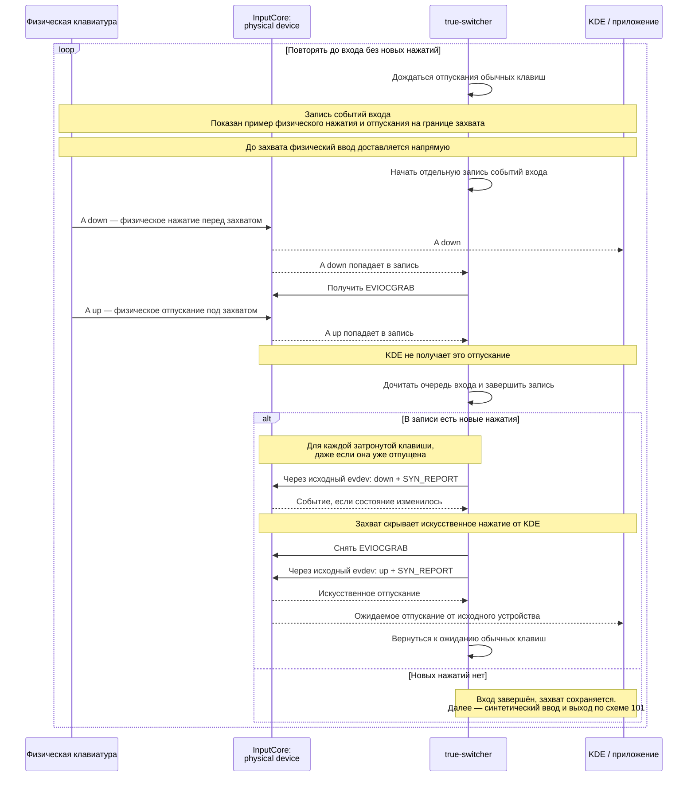

# Задача 102. Эксперимент со входом в захват и повторной попыткой

- [x] Описана схема нового входа в захват.
- [x] Реализована отдельная программа `src/bin/experiment-102.rs`, запуск `make run-capture-experiment-102`.
- [x] Основной ручной сценарий в KDE Plasma на Wayland успешно проверен пользователем; результат и журнал приведены ниже.
- Основа — [эксперимент 101](101.md). Здесь показан только новый вход в захват; сброс исходных модификаторов и `Pause`, синтетический ввод и завершение захвата описаны в 101.
- Эксперимент проверяет решение для [вопроса 4 задачи 5.3](5.3.md#4-как-согласовать-состояние-и-очередь-событий-на-границах-захвата). Основной сценарий подтверждён; внедрение в основной свитчер остаётся отдельной работой.

## Цель

Обнаруживать нажатия между наблюдением «все обычные клавиши отпущены» и получением захвата. Если нажатия обнаружены, отменять попытку, завершать потенциально доставленные окружению нажатия и возвращаться к ожиданию. Синтетический ввод разрешён только после успешного входа.

Недостаточно снять захват и отправить отпускания: если физическое отпускание уже произошло под захватом, ядро хранит состояние «отпущена» и повторное отпускание может быть отфильтровано.

Для пользователя это может выглядеть как залипшая клавиша: приложение получило нажатие до захвата, но не получило отпускание и продолжает считать клавишу нажатой, хотя палец уже убран. Например, буква может продолжать повторяться в поле ввода или стрелка — перемещать курсор после физического отпускания.

Проверяем следующий способ: искусственное нажатие через исходный `evdev` под захватом, затем снятие захвата и искусственное отпускание через тот же `evdev`.

## Новый вход в захват

На схеме показана одна физическая клавиатура. Для нескольких устройств события и искусственные нажатия/отпускания учитываются отдельно по паре «исходное устройство, код клавиши».



## Правила записи и отмены попытки

- Слушать устройства непрерывно. Завершение отдельной записи не означает остановку чтения физических событий.
- Учитывать все новые нажатия в записи, включая клавиши, которые успели отпустить. Автоповтор также считать признаком активности, требующей отмены попытки.
- Не смешивать собственные внедрённые события с новыми физическими нажатиями. Исходные сброшенные модификаторы и `Pause` обрабатываются по протоколу 101; их внедрённые отпускания сами по себе не отменяют вход.
- Искусственные нажатия для отмены выполнять, пока соответствующие исходные устройства ещё захвачены. Искусственные отпускания для окружения отправлять после снятия захвата через те же устройства.
- При отмене не выполнять синтетическое исправление. После отпусканий вернуться к первому шагу и начать новую запись для следующей попытки.
- Успешная запись через `evdev` не подтверждает обработку события KDE. Результат проверять независимым Wayland-наблюдателем, например `wev`.

## Что проверить экспериментом

| Сценарий | Ожидаемый результат |
| --- | --- |
| Во время входа новых нажатий нет | Захват сохраняется, начинается последовательность 101. |
| Клавиша нажата перед захватом и остаётся удерживаемой | Попытка отменяется; искусственное отпускание доходит до окружения, залипания нет. |
| Клавиша нажата перед захватом и отпущена под захватом | Скрытое искусственное нажатие позволяет затем доставить отпускание окружению. Лишний символ от искусственного нажатия не появляется. |
| Нажатие и отпускание целиком произошли под захватом во время записи входа | Попытка отменяется; искусственное нажатие не доставляется окружению, после возврата прямой ввод работает. |
| Несколько нажатий, автоповторы или несколько клавиатур | Все затронутые пары «устройство, клавиша» обработаны; залипания и лишнего ввода нет. |
| Новый физический ввод во время отмены попытки | Зафиксировать порядок событий и проверить, что отпускание не потеряно и скрытое нажатие не стало видимым. |

Для воспроизводимого теста реализованы настраиваемые промежутки до захвата и под захватом, по две секунды каждый. На протяжении обоих промежутков программа продолжает читать события и вести запись входа. Результаты сопоставлять с событиями Wayland-наблюдателя.

## Запуск и основной ручной тест

Перед запуском остановить основной свитчер и другие эксперименты. Использовать английскую раскладку с выключенным `Caps Lock`. Нужны чтение и запись физических `/dev/input/event*` и доступ к `/dev/uinput`, как для 101.

```sh
make run-capture-experiment-102
```

1. Дождаться `Ready`. Зажать левый Shift и нажать `Pause`, как в 101. Исходные модификаторы и `Pause` будут сброшены через исходные устройства.
2. При подсказке `[NOW!] Hold A` нажать и удерживать `A`. На этом этапе нажатие поступает в приложение напрямую. Отпустить исходные Shift и `Pause`, если они ещё удерживаются.
3. При подсказке `[NOW!] Release A` отпустить `A`. Её отпускание произойдёт под захватом.
4. Дождаться `Entry cancelled and capture released`. Программа должна выполнить скрытое `A down`, снять захваты и отправить `A up` через исходное устройство. Проверить отсутствие продолжающегося автоповтора и лишнего символа от искусственного нажатия.
5. На второй попытке повторить `Hold A` / `Release A`. Начиная с третьей попытки программа выводит `[NOW!] Do not press any keys; waiting for a clean capture`: ничего не нажимать в обоих окнах записи. После успешного входа появится последовательность `123abc` из 101.
6. После `Capture released` проверить обычный ввод и новые нажатия/отпускания Shift. Для завершения нажать `Escape`.

Один запуск выполняет столько попыток входа, сколько потребуется, затем одну последовательность 101 и наблюдает ввод до `Escape`. Для следующего сценария программу перезапустить. Для проверки доставки отпускания в KDE выполнить отдельный запуск с `wev` в фокусе и сопоставить его события с журналом. Сообщения программы показывают этапы, но сами по себе не доказывают, что физическое действие попало в нужное окно: это устанавливается по журналу.

Режим с синтетическим Shift:

```sh
make run-capture-experiment-102 EXPERIMENT_ARGS=--shifted
```

Ожидаемая последовательность — `!@#ABC`. Для более удобного воспроизведения можно увеличить оба окна:

```sh
make run-capture-experiment-102 EXPERIMENT_ARGS='--before-grab-ms 4000 --after-grab-ms 4000'
```

Дополнительные ручные сценарии:

- Оставить `A` удерживаемой до отмены попытки. Проверить доставку искусственного отпускания и отсутствие автоповтора после снятия захвата, затем физически отпустить клавишу.
- Нажать и отпустить `A` целиком в окне `GRABBED`. Её символ не должен появиться в приложении; попытка всё равно отменяется.
- Выполнить несколько нажатий или использовать несколько клавиатур. В журнале проверить адреса искусственных записей.
- Проверить `Escape` во время прямого ввода, записи под захватом, последовательности 101 и ожидания отпусканий. Везде должны выполняться попытки очистки.
- Отдельно исследовать физический ввод во время отмены с `EXPERIMENT_ARGS='--rollback-gap-ms 2000'`. Это добавляет паузу **после скрытых нажатий, до снятия захвата**. При сообщении `ROLLBACK hidden downs sent` физически отпустить удерживаемую клавишу. Такая пауза специально открывает оставшуюся гонку: физическое отпускание может снова перевести ядро в `up`, скрыться от KDE и помешать последующему искусственному `up`. Параметр служит для исследования ограничения, а не для его устранения.

Каждая задержка задаётся в миллисекундах от 0 до 60000. Значения по умолчанию: `--before-grab-ms 2000`, `--after-grab-ms 2000`, `--rollback-gap-ms 0`. Справка доступна без открытия устройств: `cargo run --offline --bin experiment-102 -- --help`.

## Реализация записи и журнала

- Сначала дочитываются доступные события и запрашивается состояние устройств для ожидания обычных клавиш. Затем начинается новая запись, сбрасываются исходные модификаторы и `Pause`, выполняются оба окна и захват между ними. Собственные исходные отпускания имеют `value=0` и не считаются новыми нажатиями.
- Перед завершением записи дочитываются доступные очереди, запрашивается текущее состояние всех устройств и снова дочитываются очереди. Удерживаемые клавиши из снимка также добавляются в набор отмены. Это консервативный способ обнаружения активности, а не атомарная граница для нескольких устройств.
- В записи сохраняются пары «устройство, код клавиши» для `value=1` и `value=2`; отпускания не удаляют их из набора. Запись выключается перед искусственными нажатиями отмены. Всё время продолжается обычное журналирование событий.
- Для повторного нажатия при отмене поддерживаются стандартные клавиши с кодами от `KEY_ESC` до `KEY_KPDOT`, кроме `Caps Lock`, `Num Lock` и `Scroll Lock`, а также восемь модификаторов, `Pause`, навигационные клавиши, `F11`, `F12`, `KEY_102ND`, `KEY_KPENTER` и `KEY_KPSLASH`. Для неподдерживаемой клавиши искусственное нажатие не отправляется, эксперимент завершается с ошибкой и попыткой очистки. Первые ручные тесты проводить с `A`.
- При ошибке, включая частичный захват или `SYN_DROPPED`, эксперимент прекращает последовательность и пытается выполнить очистку. Для уже захваченных устройств при незавершённом входе выполняются скрытые нажатия известных поддерживаемых клавиш, снятие захватов и отпускания; собственные виртуальные клавиши также отпускаются. Устройства, которые не удалось захватить, не получают искусственного `down`. Очистка не является гарантией восстановления при потере событий или отказе записи.

Каждый запуск создаёт новый файл `experiment-102-<дата UTC>-<счётчик>.log` в каталоге проекта; путь выводится при запуске. Журнал содержит коды набираемых клавиш.

- `RECORD_BEGIN` / `RECORD_END` — номер попытки и набор нажатий для отмены. Индекс устройства соответствует порядку строк `OPEN`.
- `EVDEV origin=unknown` — прочитанные события, `kernel_time`, состояние захвата в момент чтения, признак активной записи и номер попытки. После внедрения события нельзя считать исключительно физическими.
- `STATE` — снимки состояния ядра; после искусственных записей это не независимый показатель физического удержания.
- `GRAB`, `UNGRAB`, `SOURCE_WRITE attempt/result` — операции по исходным устройствам. `value=1` под захватом и `value=0` после его снятия показывают протокол отмены. Успешная запись не подтверждает доставку KDE.
- `ROLLBACK`, `ENTRY_ACCEPTED`, `SYNTHETIC`, `WAIT_RELEASES`, `FINISH`, `CLEANUP` — отмена, переход к 101, вывод, ожидание и завершение.

## Открытые вопросы

### 1. Как определить границы записи входа?

Нужно задать порядок обработки ранее накопленных событий, начала записи, получения захватов и дочитывания очередей. Момент чтения события не равен моменту его возникновения. Для нескольких клавиатур захват получается последовательно.

Порядок первой реализации описан выше. Основной сценарий на реальном устройстве прошёл успешно; остальные пограничные случаи этим запуском не подтверждены.

**Ответ:**

### 2. Как обработать новые события во время отмены попытки?

Между скрытым искусственным нажатием, снятием захвата и искусственным отпусканием может произойти физическое отпускание или новое нажатие. Согласованная схема пока не задаёт обработку этой гонки и частичного получения захватов. Эксперимент должен исследовать эти случаи, а не считать отмену атомарной.

**Ответ:**

### 3. Какие клавиши включить в эксперимент?

Нужно определить перечень клавиш для искусственного нажатия при отмене. Для клавиш переключения режимов, например `Caps Lock` и `Num Lock`, искусственное нажатие может изменить состояние режима даже под захватом; схему нельзя автоматически распространять на них.

Первая реализация ограничивает перечень описанными выше клавишами и не внедряет повторные нажатия переключателей режимов. Расширение перечня остаётся открытым вопросом.

**Ответ:**

## Результат

2026-11-03: пользователь подтвердил успешный результат эксперимента 102 в обычном режиме (`shifted=false`). Журнал — [experiment-102-2026-11-02_21-41-49.849974641Z-0.log](../../experiment-102-2026-11-02_21-41-49.849974641Z-0.log).

- На первых двух попытках `A` нажата до захвата и физически отпущена под захватом. В обеих попытках выполнены скрытое искусственное `down` через исходный `/dev/input/event14`, снятие всех захватов и искусственное `up` через то же устройство. Отмены завершились без ошибок на 7,075 с и 11,135 с.
- На третьей попытке новых нажатий в записи нет; на 15,137 с вход принят. Выполнена синтетическая последовательность `123abc`, к 20,182 с все захваты сняты. После этого в журнале виден обычный ввод. Завершение через `Escape` — `FINISH Ok(())`, очистка без ошибок.
- Результат основан на наблюдении пользователя и журнале свитчера. Отдельный журнал Wayland-наблюдателя для этого запуска не представлен.

По согласованию с пользователем режим `--shifted` не требуется для признания эксперимента 102 успешным: он проверяет вход и отмену захвата, а синтетический Shift используется уже после успешного входа. Дополнительные сценарии, включая новые физические события во время самой отмены, не отмечены как выполненные. Успех эксперимента 102 не означает завершения задачи 5.3.

При подготовке реализации прошли сборка `cargo build --offline --bin experiment-102`, пять тестов `cargo test --offline --bin experiment-102`, линтинг `cargo clippy --offline --bin experiment-102 -- -D warnings` и форматирование `rustfmt --edition 2024 --check src/bin/experiment-102.rs`. Справка `--help` выполнена без открытия устройств, команда Makefile просмотрена через `make -n`.
